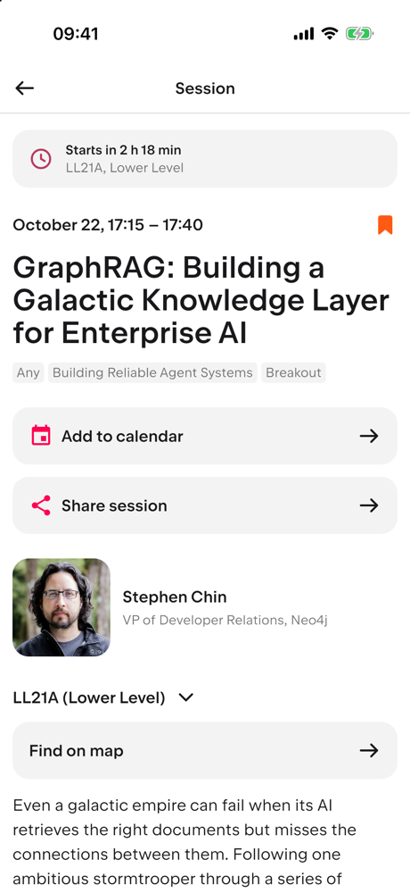
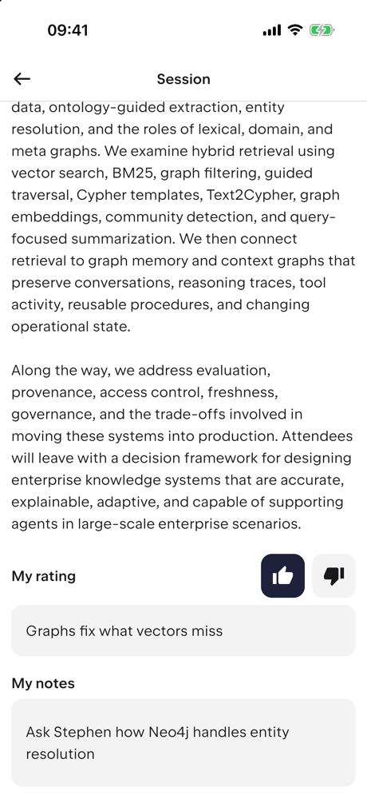
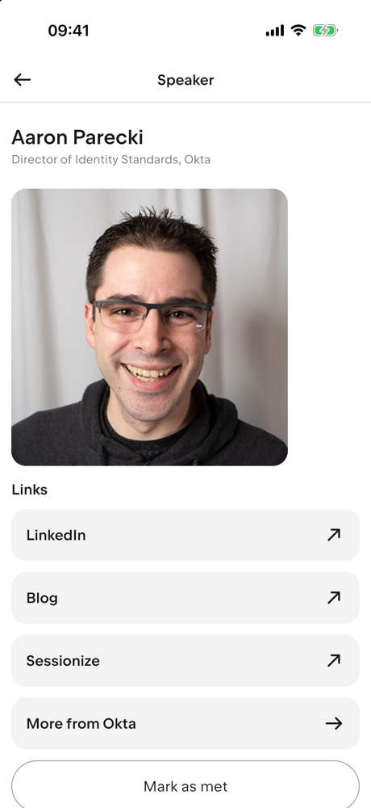
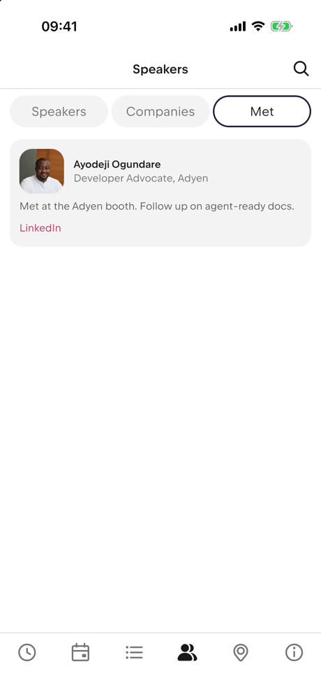
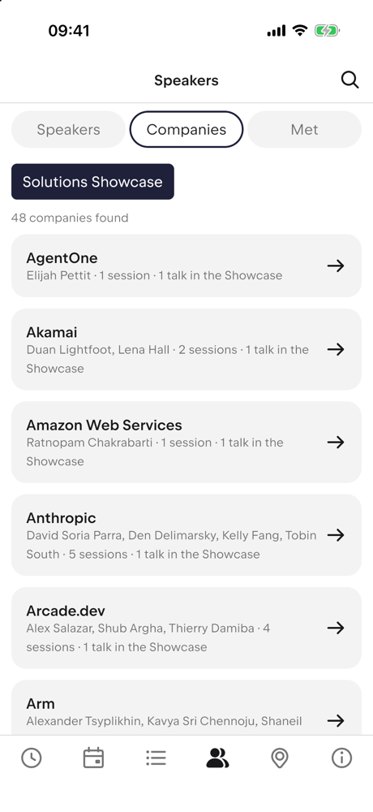
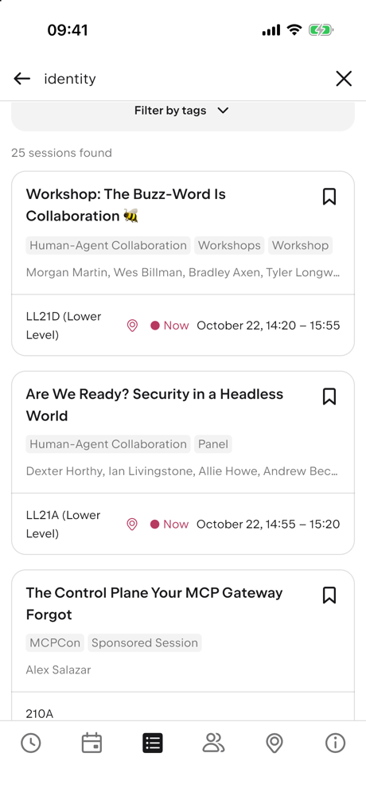
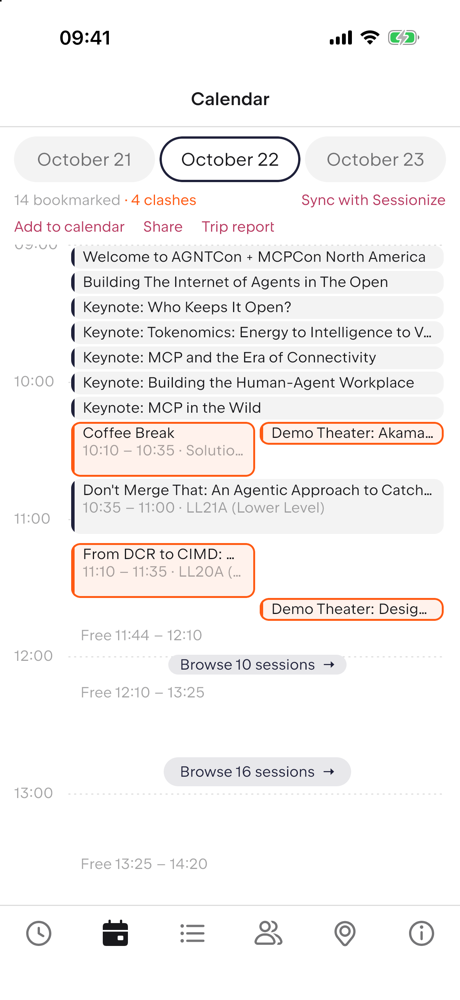
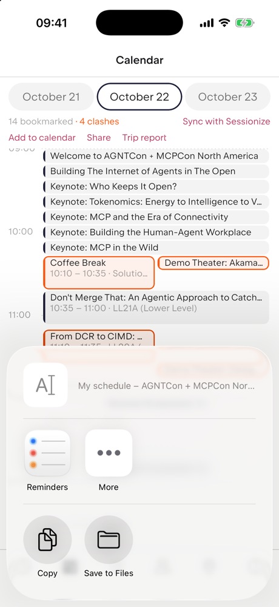

# Sessionize Conference App

A conference app for any event that publishes its schedule on [Sessionize](https://sessionize.com): Android, iOS,
desktop and web from one Kotlin Multiplatform codebase. It is currently set up for
[AGNTCon + MCPCon North America 2026](https://events.linuxfoundation.org/agntcon-mcpcon-north-america/).

## Credit

This is a fork of the [KotlinConf app](https://github.com/JetBrains/kotlinconf-app) by
[JetBrains](https://www.jetbrains.com/) and its [contributors](https://github.com/JetBrains/kotlinconf-app/graphs/contributors).
Its architecture, screens, design system and most of the code are theirs: the shared Compose Multiplatform UI,
navigation, schedule, speakers, search and filters, session reminders, and the Ktor backend. Thank you to the KotlinConf
team for building it so well and for publishing it under the Apache License 2.0.

This fork is not affiliated with or endorsed by JetBrains, KotlinConf, Sessionize or the Linux Foundation.
KotlinConf and Kodee are trademarks of JetBrains. The AGNTCon + MCPCon name and logo belong to the Linux Foundation and
are used here only to theme the AGNTCon build. The code is under the [Apache License 2.0](LICENSE), as the original;
the changes made in this fork are listed below and in the git history.

## What this fork adds

**Any Sessionize conference, with or without a backend**
- Conference profiles ([`EventProfiles.kt`](app/shared/src/commonMain/kotlin/org/jetbrains/kotlinconf/event/EventProfiles.kt)):
  name, time zone, links, theme and data source per conference, picked at build time with `-Pevent=<id>`.
- Reads a public Sessionize feed directly, so a conference needs no server of its own. Times work whether the feed sends
  UTC or event-local times; schedule filters (topic, level, format) come from the feed's categories.
- Features that need the KotlinConf backend (voting, feedback, Golden Kodee, maps, partners, legal documents, push
  notifications) are hidden for such conferences; KotlinConf itself still builds as before (`-Pevent=kotlinconf`, the default).
- Per-conference look: light and dark colors, logo, app icon and launch screen.

**Planning your conference**
- **My schedule**, a tab with two views:
  - **Day**: your bookmarked sessions on a timeline. Overlapping sessions sit side by side and are marked as clashes;
    all-day items (registration, exhibitions) stay out of the way; free time is split at the conference's own breaks
    (breakout rounds, lunch) with a button to browse the sessions starting then and bookmark them in place.
  - **Now**: during the conference, what you are in and how long is left, what's next and how soon, its room and floor
    (with a hint when you need to change floors), free time before it, and the rest of the day.
- **Session pages** open with how long until the session starts (or how long is left), its room and floor, highlighted
  in the last 15 minutes, so you can tell at a glance whether you are in the right room for the right session.
- **Sync with the Sessionize web app**: link with the 6-digit code from the event's web app ("Sync favorites") and
  bookmarks stay in step both ways. This uses the same calls as Sessionize's own web app; they are not a documented
  API and may change, in which case the app keeps working from its own bookmarks.

**At the conference: notes, people and sharing** (all of it stays on your device; nothing needs a server)

  
  
  
  

  
  
  
  

- **Notes** on any session or speaker, **People I met** (mark a speaker as met; the Met tab lists them with your note and
  their LinkedIn link) and **private ratings** (thumbs up or down and a one-line takeaway; shown for events without
  their own voting).
- **Add to calendar** for one session or all your bookmarks (an `.ics` file), **share** a session or your schedule as
  text, and a **trip report** in Markdown: your sessions in time order with speakers, rating, takeaway, notes, slides and
  recordings, plus the people you met. It goes through the platform's share sheet.
- **Companies**: speakers' companies from the feed, searchable, with a **Solutions Showcase** filter to browse exhibitor
  talks by company; a company filter in the schedule's search; speaker links (LinkedIn, blog, company site).
- **Better search**: the schedule search also matches session descriptions and speakers' companies, and **Find on map**
  on a session's room (and a pin on schedule rows) opens the venue map on that room.

**Fixes to the original**
- Sessions are grouped into their own time slots; a long session (such as all-day registration) no longer swallows the
  sessions inside it.
- Duplicate list keys that crashed the schedule's bookmarks view when time slots shared a start time.
- Short day labels when a conference has more days than fit on a phone.

**Testing**
- Snapshots of real Sessionize feeds ([`testdata/sessionize`](testdata/sessionize)) for one event-local and one UTC
  conference. Tests check parsing and time zones, schedule grouping, unique list keys and the personal calendar over many
  random sets of bookmarks; each was confirmed to fail with the bug it guards against.
- The Sessionize sync client is tested against a mock server with the requests and responses of the real web app.
- The GitHub Actions workflow runs the core and app tests and the iOS build for each conference profile.

## Building for a conference

1. [Set up your environment](https://www.jetbrains.com/help/kotlin-multiplatform-dev/multiplatform-setup.html) for
   Kotlin Multiplatform development (JDK 21, Xcode for iOS).
2. Find the event's Sessionize API id. Event schedule pages that embed Sessionize contain URLs such as
   `https://sessionize.com/api/v2/{id}/view/GridSmart`; check that `https://sessionize.com/api/v2/{id}/view/All`
   returns JSON. For bookmark sync, note the event's web app address (`https://<event>.sessionize.com`).
3. Add an `EventProfile` with that `sessionizeId`, the venue's time zone (e.g. `America/Los_Angeles`), name, about
   text and links, and optionally a theme ([`EventTheme.kt`](app/shared/src/commonMain/kotlin/org/jetbrains/kotlinconf/event/EventTheme.kt)).
   For iOS, add `AppIcon-<id>`, `<id> launch` and `<id> launch background` to the asset catalog to give the build its
   own icon and launch screen.
4. Build with `-Pevent=<profile id>`:
   * Web: `./gradlew -Pevent=agntcon-mcpcon-na-2026 :app:webApp:wasmJsBrowserDevelopmentRun`
   * iOS to TestFlight: `scripts/ios-testflight.sh agntcon-mcpcon-na-2026 <bundle id> <display name> <team id> --upload`
     (needs an App Store Connect app record and API key; see the script)
   * Tests: `./gradlew -Pevent=agntcon-mcpcon-na-2026 :core:jvmTest :app:shared:jvmTest`

   Android and desktop share the same code but have not yet been tried with a profile that has no backend; Android
   still uses KotlinConf's application id and Firebase setup.

The backend (`:backend`) reads the same feed format; set `conference.timeZone` and the `sessionize.*` rules in
`application.yaml` for another conference.

## The original KotlinConf app

The KotlinConf app is published for [Android](https://play.google.com/store/apps/details?id=com.jetbrains.kotlinconf),
[iOS](https://apps.apple.com/us/app/kotlinconf/id1299196584) and the [web](https://jetbrains.github.io/kotlinconf-app/).
To build it from this fork, leave out `-Pevent` or use `-Pevent=kotlinconf`:

* Android: use the `app.androidApp` run configuration
* iOS: use `KotlinConfAppScheme`
* Desktop: `./gradlew :app:desktopApp:hotRun -DmainClass=org.jetbrains.kotlinconf.MainKt`
* Web: `./gradlew :app:webApp:wasmJsBrowserDevelopmentRun`
* Backend: `./gradlew :backend:run`
