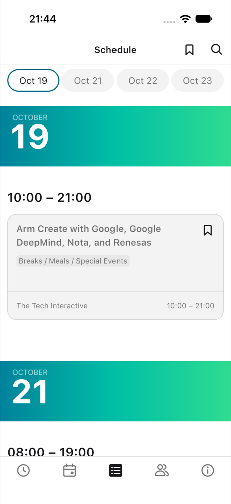
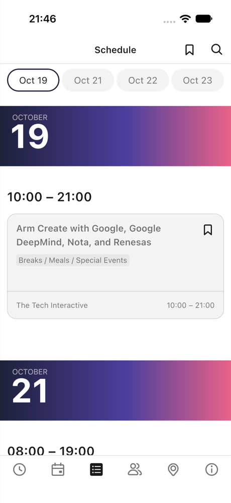
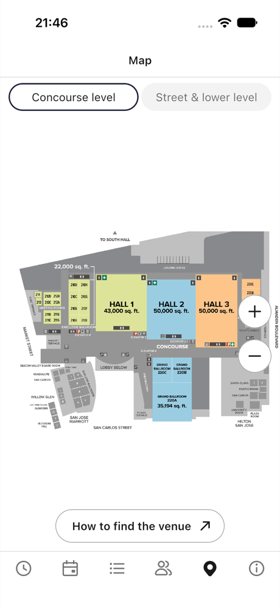
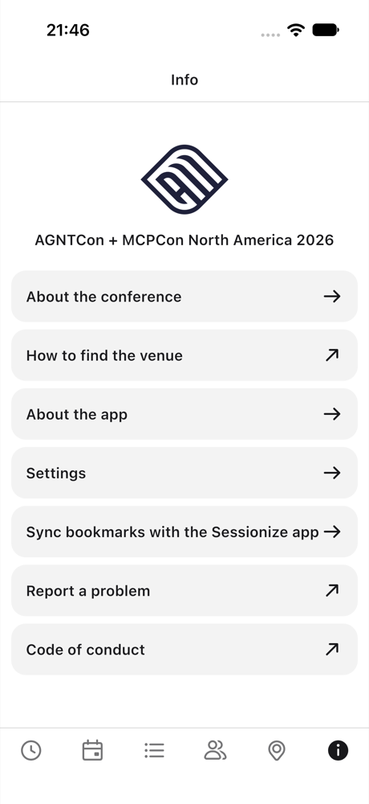
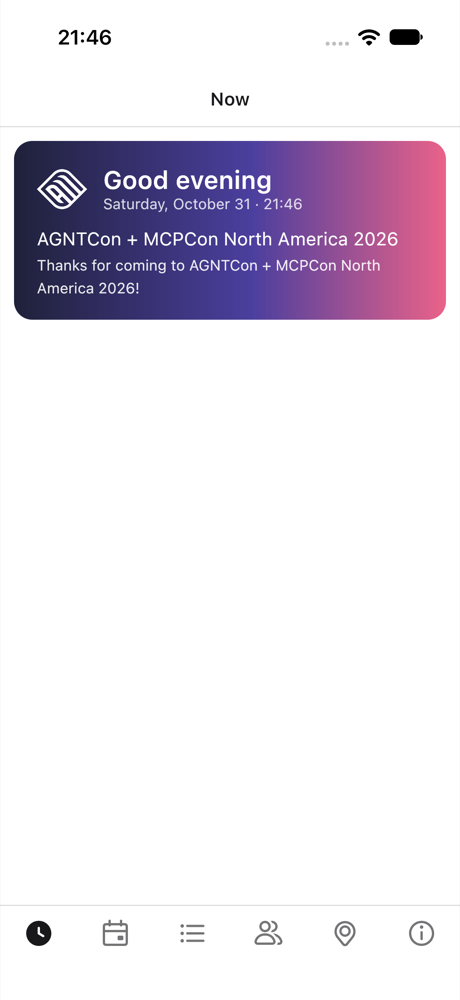

# Fork it, brand it, ship it

Sessionable is a conference app for any event that publishes its schedule on
[Sessionize](https://sessionize.com). There is no server: the app reads the event's public Sessionize feed, and
everything the attendee adds (bookmarks, notes, ratings, people met, photos) stays on the device.

There are two ways to use this repository.

1. **The generic app.** Build it as it is. On first launch it asks for a Sessionize link, checks it, and opens that
   conference. Attendees can connect to several conferences and switch between them. This is what the stores get.
2. **A branded app for one conference.** Fork it, change the few files below, and the app opens straight on your
   conference with your name, colors and icon, and no connect screen.

## Why fork this instead of building your own

An event app is quick to start and slow to finish. The schedule is the easy part. What takes the time is everything
the stores, the platforms and your attendees expect around it. This repository has already been through that, so a
fork starts at "make it yours", not at "why was it rejected".

- **No backend to run.** The app reads the event's public Sessionize feed and keeps everything the attendee adds on the
  device. There is no server to host, secure, scale or pay for after the event, and no accounts to manage.
- **Privacy that the stores accept.** The app collects nothing: no analytics, trackers, crash reporters or push
  services. The iOS privacy manifest declares that (no tracking, no collected data types), the App Privacy answer is
  "Data Not Collected", and `docs/site/privacy.html` is a ready policy page to host. The push entitlement and unused
  background modes are removed, since an entitlement the app does not use is a common review question.
- **A launch that was fixed and is now tested.** A start-up crash on iOS (a global read from a background coroutine)
  was found through TestFlight feedback and fixed. The tests now build the real dependency graph, restart it over the
  same storage and check that the conference comes back, in both the generic and the branded build.
- **Accessibility, checked by a machine, not just promised.** An XCUITest runs Apple's accessibility audit on the
  connect screen, onboarding and every tab, at the normal text size and at the largest accessibility size. It found and
  this repo fixed unnamed icon buttons and doubled or wrong field labels. Text follows the system's Larger Text
  setting. You should still do a VoiceOver and TalkBack pass yourself before you claim anything in the stores.
- **Store plumbing done once.** Icons for iOS, Android and web come from one image (`scripts/make-icons.sh`).
  Versions are bumped in all four places together. CI builds each conference profile, runs the tests, and uploads to
  TestFlight and Google Play when you add the secrets. `docs/RELEASING.md` lists the listing fields and the order of the
  steps that trip people up (for example, the privacy URL must answer before you enter it).
- **Real feeds in the tests.** Snapshots of two real Sessionize conferences, one with event-local times and one in UTC,
  check parsing, time zones, schedule grouping and the personal calendar. Most event apps get time zones wrong at
  least once.
- **The features attendees ask for, already there.** Now and My schedule, clashes, notes, ratings, people met,
  calendar export, a trip report, a venue map, search, companies, in English, German, Spanish, French and Brazilian Portuguese.
- **Open and credited.** It is Apache-2.0, built on JetBrains' KotlinConf app, which has years of conference use behind
  its design. You keep the credit and the "unofficial" wording; you change the name, colors and icon.

What you still do yourself: the developer accounts, signing, the store listing and screenshots, the name and
trademark check, hosting the privacy and support pages, and the manual accessibility pass.

## What a Sessionize link is

On the event's Sessionize dashboard, under API / embed, enable the **All** endpoint. Its link looks like
`https://sessionize.com/api/v2/abcd1234/view/All`; the id is `abcd1234`. The app accepts that link, any other
`/api/v2/<id>/...` link of the event, or the bare id.

## What a branded app looks like

The same screens, with the AGNTCon + MCPCon North America 2026 profile selected (`-Pevent=agntcon-mcpcon-na-2026`): its
colors and gradient, its logo mark, its venue map tab, its name and links. The first picture is the generic build, for
comparison.

<p>
  
  
  
</p>
<p>
  
  
</p>

## A branded app in five steps

1. **Describe the conference.** In `app/shared/src/commonMain/kotlin/org/jetbrains/kotlinconf/event/EventProfiles.kt`
   add an `EventProfile`: the Sessionize id, name, time zone, links, and optionally a theme (`EventTheme`), a
   venue floor plan (`VenueMap`) and `SessionizeRules` for questions your event asks speakers (for example where
   slides are uploaded). `AgntconMcpconNa2026` is a complete example. Keep `storageScope` stable once the app has
   shipped: changing it makes installed apps lose their data.
2. **Select it.** Set `event=<your profile id>` in `gradle.properties` (or pass `-Pevent=<id>`; Xcode builds read
   `ORG_GRADLE_PROJECT_event`). With a value there is no connect screen and no "Switch conference".
3. **Name the app.**
   - Android: `appId` in `gradle.properties`, and `app_name` in `app/androidApp/src/main/res/values/strings.xml`.
   - iOS: `PRODUCT_BUNDLE_IDENTIFIER` and `PRODUCT_NAME` in `app/iosApp/Sessionable.xcodeproj/project.pbxproj`,
     or pass them to `scripts/ios-testflight.sh <event-id> <bundle-id> <display-name> <team-id>`.
   - Versions live in four places that must agree (Android `build.gradle.kts`, the iOS project and `Info.plist`,
     `values/version.xml`); `./gradlew prepareRelease` bumps them together.
4. **Replace the icon.** Put a square, opaque picture of at least 1024 px at `branding/icon.png`, set the web loading
   page colors in `branding/brand.env`, and run `scripts/make-icons.sh`. It writes the iOS, Android and web icons,
   the iOS launch image and the web splash screens.
   The launch screens show the white part of your icon on the brand color. For something better, put a picture of your
   own at `branding/splash.png` (white on a transparent background, any shape, the full artwork inside the picture);
   `scripts/make-icons.sh` fits it into each platform's launch screen, including Android 12's circular mask.
5. **Fix the credits and links.** `URLs.kt` has the project's GitHub repository (used by "Report a problem").
   Keep the JetBrains credit, the Apache-2.0 licence and the "unofficial, not affiliated" wording, which the
   licence and the trademarks of the parts this builds on require.

For the web build, copy `app/webApp/branding/generic` to a folder named for your event, edit `manifest.json` and
`brand.env`, and point `BRAND` and `EVENT` in `.github/workflows/web-deploy.yml` at them.

## Let Claude do it

This repository has a Claude Code skill that walks through all of the above: it asks for your Sessionize link, name,
dates, venue, colors and logo, writes the profile and theme, names the app, makes the icons, builds and tests it,
captures screenshots, and finishes with the store checklist. In a fork, open Claude Code and ask it to
"brand this app for my conference"; the skill is `.claude/skills/brand-for-your-conference/SKILL.md`, and the steps in it
are the same ones you can follow by hand.

## Screenshots for the stores

`SessionableUITests/ScreenshotTests` walks the app and saves a PNG of each screen to
`/private/tmp/sessionable-shots/`. It uses the generic build's connect screen when there is one and the branded build's
onboarding when there is not:

```bash
cd app/iosApp
ORG_GRADLE_PROJECT_event=<your event id> xcodebuild test -scheme SessionableScheme -configuration Debug \
  -destination 'platform=iOS Simulator,name=iPhone 17' -only-testing:SessionableUITests/ScreenshotTests \
  CODE_SIGNING_ALLOWED=NO
```

It needs the network (it reads your real feed), and the app must be uninstalled from the simulator first so it starts
clean. Take the store images from the device sizes the stores ask for.

## What is in the box

- Schedule, search and filters (topic, level, format, company), speakers and companies, a venue map where the
  profile has one.
- **Now** and **My schedule** tabs: what is on now and next, your bookmarks on a timeline with clashes marked.
- Notes on sessions and speakers, private ratings, people met, add to calendar (`.ics`), share, a Markdown trip report.
- Photos and videos, attached from a session's own page (camera, library or files; not in the web build).
- Optional sync of bookmarks with the event's Sessionize web app, for profiles that set `sessionizeAppUrl`.
- English, German, Spanish, French and Brazilian Portuguese. The attendee gets the phone's language when it is one of
  these, English otherwise. The schedule itself is in whatever language the organiser wrote it in Sessionize.

## Build and test

```bash
./gradlew :core:jvmTest :app:shared:jvmTest          # tests (snapshots of real feeds in testdata/)
./gradlew :app:androidApp:assembleDebug              # Android (needs the SDK; JDK 21)
./gradlew :app:webApp:wasmJsBrowserDevelopmentRun    # web
scripts/ios-testflight.sh <event-id> <bundle-id> <display-name> <team-id> --upload
```

Pass `-Pevent=<id>` to any of them to build a branded app instead of the generic one.

## Connect by QR code

An organiser can put a QR code on a poster or the programme that opens the generic Sessionable build and checks the
conference. The QR holds this link, with the id from the event's Sessionize API link
(`https://sessionize.com/api/v2/<id>/view/All`):

```
sessionable://connect?id=<id>
```

The phone's camera app offers to open it in Sessionable, which fills in the id and checks the feed. The attendee
still names the conference and confirms its time zone. A conference that is already saved is opened directly. Branded
builds ignore the link. The app has no scanner of its own and needs no extra permission.
